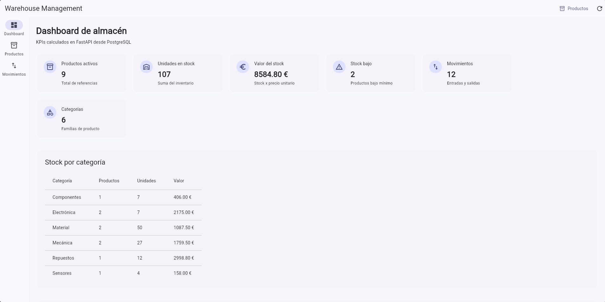
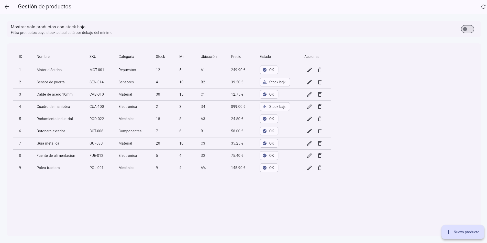
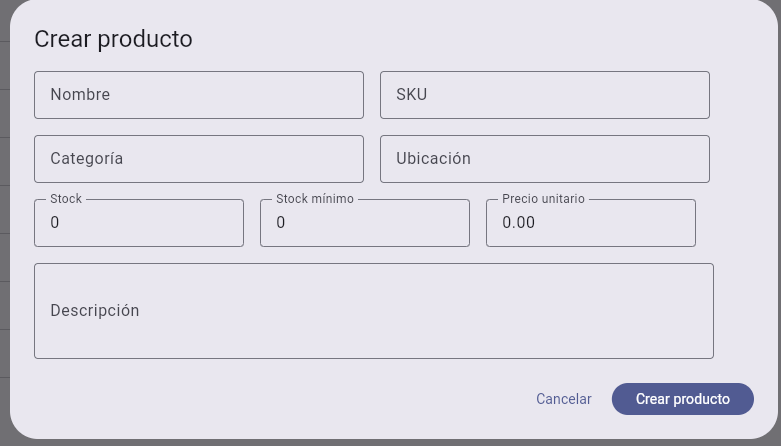
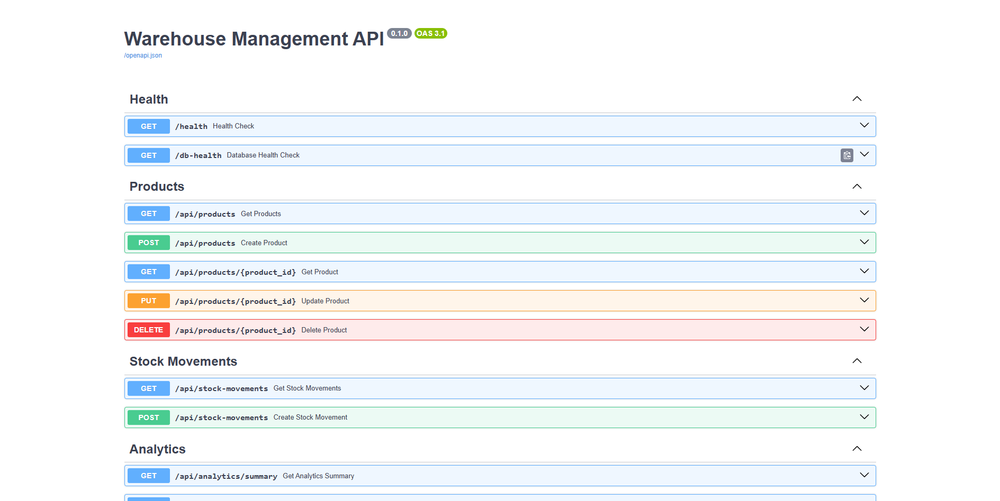

# Warehouse Manager Demo

Demo web de gestión de almacén construida con Flutter Web, FastAPI, PostgreSQL y Docker.

## Funcionalidades

- Dashboard con KPIs de stock
- CRUD de productos
- Entradas y salidas de inventario
- Historial de movimientos
- Alertas de stock bajo
- Datos de prueba precargados
- API documentada con Swagger
- Despliegue local con Docker Compose

## Stack técnico

- Flutter Web
- FastAPI
- PostgreSQL
- Docker
- Docker Compose
- Nginx

## Requisitos

- Docker
- Docker Compose

No es necesario tener Flutter ni Python instalados para ejecutar la demo con Docker.

## Capturas

### Dashboard

Vista principal con KPIs calculados desde el backend FastAPI y datos almacenados en PostgreSQL.



### Gestión de productos

Pantalla CRUD para consultar, crear, editar y eliminar productos del almacén.



### Formulario de producto

Modal de creación y edición de productos con validaciones básicas.



### API documentada con Swagger

Documentación interactiva generada automáticamente por FastAPI.



## Instalación rápida

## Guía de ejecución local

Esta guía permite arrancar el proyecto completo en local.

La aplicación está compuesta por:

* Frontend: Flutter Web servido con Nginx mediante Docker.
* Backend: API REST con FastAPI ejecutada localmente con Uvicorn.
* Base de datos: PostgreSQL ejecutado con Docker Compose.

## Requisitos previos

Antes de empezar, asegúrate de tener instalado:

* Git
* Docker Desktop
* Python 3.12 o superior

No es necesario tener Flutter instalado para ejecutar la demo, ya que el frontend se compila dentro de Docker.

## 1. Clonar el repositorio

```bash
git clone https://github.com/DDargn/warehouse-management-demo.git
cd warehouse-management-demo
```

## 2. Crear archivo de variables de entorno

Copia el archivo de ejemplo:

```bash
cp .env.example .env
```

El archivo `.env` contiene la configuración local de PostgreSQL, el puerto del frontend y la URL del backend.

## 3. Levantar PostgreSQL y frontend

Desde la raíz del proyecto:

```bash
docker compose up -d --build
```

Esto levantará:

* PostgreSQL en `localhost:5432`
* Frontend en `http://localhost:8080`

Puedes comprobar los servicios con:

```bash
docker compose ps
```

## 4. Preparar el backend

Entra en la carpeta del backend:

```bash
cd backend
```

Crea un entorno virtual:

```bash
python -m venv .venv
```

En Windows con Git Bash, activa el entorno virtual con:

```bash
source .venv/Scripts/activate
```

Instala las dependencias:

```bash
pip install -r requirements.txt
```

## 5. Arrancar FastAPI

Desde la carpeta `backend`, con el entorno virtual activado:

```bash
uvicorn app.main:app --reload --host 127.0.0.1 --port 8001
```

La API estará disponible en:

```txt
http://127.0.0.1:8001
```

La documentación Swagger estará disponible en:

```txt
http://127.0.0.1:8001/docs
```

## 6. Abrir la aplicación

Con Docker y el backend arrancados, abre en el navegador:

```txt
http://localhost:8080
```

La aplicación Flutter Web consumirá la API FastAPI desde:

```txt
http://127.0.0.1:8001
```

## URLs útiles

| Servicio        | URL                                           |
| --------------- | --------------------------------------------- |
| Frontend        | `http://localhost:8080`                       |
| API FastAPI     | `http://127.0.0.1:8001`                       |
| Swagger         | `http://127.0.0.1:8001/docs`                  |
| Health check    | `http://127.0.0.1:8001/health`                |
| Database health | `http://127.0.0.1:8001/db-health`             |
| Productos       | `http://127.0.0.1:8001/api/products`          |
| Analytics       | `http://127.0.0.1:8001/api/analytics/summary` |

## Reiniciar la base de datos

Si quieres borrar los datos locales y volver a cargar los datos iniciales de `seed.sql`, ejecuta desde la raíz:

```bash
docker compose down -v
docker compose up -d --build
```

Importante: el comando `docker compose down -v` elimina el volumen de PostgreSQL y borra los datos locales.

## Apagar el proyecto

Para parar el backend, usa en la terminal de Uvicorn:

```txt
CTRL + C
```

Para parar los contenedores Docker, ejecuta desde la raíz:

```bash
docker compose down
```

## Ejecución rápida

Después de la primera instalación, normalmente bastará con ejecutar:

Terminal 1:

```bash
cd warehouse-management-demo
docker compose up -d
```

Terminal 2:

```bash
cd warehouse-management-demo/backend
source .venv/Scripts/activate
uvicorn app.main:app --reload --host 127.0.0.1 --port 8001
```

Y abrir:

```txt
http://localhost:8080
```


